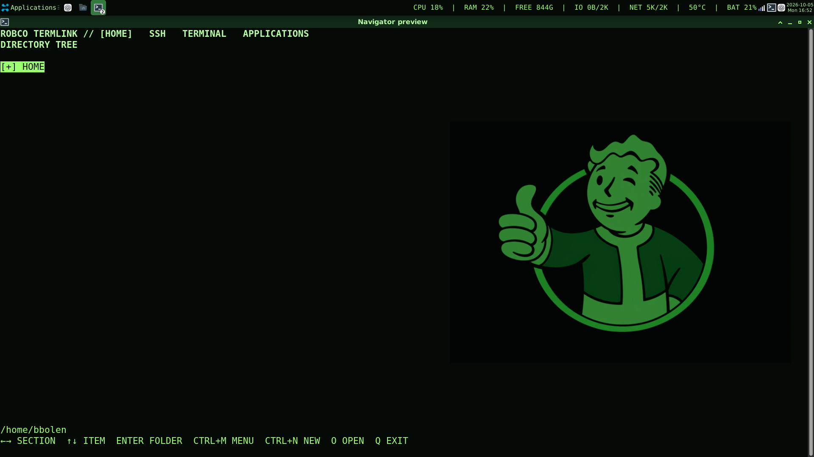

# Fallout XFCE

A Pip-Boy inspired XFCE desktop: bright green on black, a 36px system panel, and a full-height F12 navigator with embedded terminals.



## Quick start

Terminal history is retained per session (10,000 lines by default, configurable
under Display). In an attached SSH TUI session, F3/F4 scroll history. Return with
Ctrl+], select the session and press M for history selection and plain-text
copy/export. The desktop terminal context menu also offers full-history copy
and export. See [terminal history and export](docs/terminal-history.md) for details.

For easy native mouse copying over SSH, press **F5** (**Fn+F5** on many Macs).
Copy view prints the session's retained output as continuous plain text so your
terminal can scroll and select it normally. Copy between the BEGIN/END markers,
then press Enter to resume the TUI. No export file or Terminal configuration is
needed.

Tested on **Debian 13, XFCE, X11**. Copy the entire project to a permanent directory, then run these commands from a terminal in your logged-in desktop session:

```sh
./install.sh --check  # Read-only dependency check
./install.sh          # Install missing packages and configure the desktop
```

Run as your normal user. The installer uses sudo for missing Debian packages and the system login-screen background and checks GTK, VTE, and audio support before changing desktop settings. Keep the project directory in place: desktop launchers and wallpaper reference its files.

Installation sets the Pip-Boy wallpaper on connected monitors and workspaces, disables wallpaper cycling, and hides desktop icons. Desktop launchers (`.desktop` files) and symbolic links are moved into the backup; ordinary files and folders are kept. Restore returns removed shortcuts when their original paths are unoccupied.

Press **F12** to show or hide the navigator. If F12 already has a custom binding, the installer uses **Ctrl+Alt+F12**.

### Run over SSH

After connecting to a machine with this checkout, run:

```sh
~/fallout-overlay/fallout
```

The launcher automatically uses the terminal navigator in SSH, including when X forwarding is enabled. Use the actual checkout path if it is installed elsewhere. `./fallout --terminal` forces terminal mode locally. You can also launch it directly with `ssh -t user@host '~/fallout-overlay/fallout'`.

In the SSH navigator, press **F1 / F2** (or **[ / ]**) to change sections, **Ctrl+I** (or Tab) for shortcut help, and **Q** to return to your SSH shell. In an attached terminal, **F1 / F2** switches to the previous/next session and **Ctrl+]** returns to the navigator. These shortcuts work without configuring Apple Terminal; ordinary Up/Down arrows remain available for shell history. Ctrl+Shift+arrow shortcuts are optional for terminals that forward their modifiers. Ctrl+G toggles the saved Ctrl/Super section-navigation modifier. Graphical applications and desktop dialogs require the local desktop; terminal applications run in the SSH terminal. This mode leaves the graphical overlay running independently.

Restore the captured desktop configuration with:

```sh
./restore.sh
```

The first backup is preserved at `~/.local/state/fallout-ui/original`; reinstalling never replaces it. Restore replaces subsequent changes to the captured desktop settings. Installed system packages remain installed.

The navigator background is transparent by default, showing your desktop behind the green text. Toggle **Settings → Transparent background** to switch to the opaque Pip-Boy background; the preference saves immediately. Installation enables XFCE compositing for transparency.

The LightDM GTK login screen uses a solid black background after installation and plays the same success and failure login sounds as the app. Cancel remains silent. The installer builds a small audio adapter on Debian and copies the two WAV files into a system-readable directory, so the login screen does not depend on files in your home directory. Its original configuration is backed up under `/var/lib/fallout-ui/greeter-background` and restored by `restore.sh`.

In Settings, select **Section shortcut** and press Enter to toggle between **Ctrl + Left/Right** (default) and **Super + Left/Right**. The choice saves and applies immediately in the embedded navigator.

Select **Settings → Update** once to check the configured Git upstream. If no update is available it displays **System up to date**. If updates are available it automatically pulls with `--ff-only`, runs `./install.sh` in a separate terminal for sudo prompts, and closes active sessions and restarts the overlay after installation succeeds. Local changes and local commits must be resolved first. Git authentication uses the checkout’s configured remote.

## Everyday controls

| Control | Action |
| --- | --- |
| Ctrl + Left / Right | Switch Home, Data, SSH, Terminal, Applications, Settings |
| Left / Right in Data | Switch Root, Home, saved servers, Network, and + Server |
| Up / Down, Enter | Select and open |
| Backspace / Escape | Return or cancel |
| Ctrl+M on a file | File actions |
| Ctrl+N on a directory | Create a file or directory |
| O | Open a document or start a shell in a directory |
| H | Toggle hidden files |
| Ctrl+Shift+B | Toggle background transparency and save the setting |
| Ctrl+Shift+W in a terminal | Close the active session and return to the navigator |
| Ctrl+] in a terminal | Return to the navigator; keep the session running |
| Ctrl+Up / Ctrl+Down | Switch running terminal sessions |
| Ctrl+Shift+C / V | Copy / paste terminal text |
| Q in the navigator | Exit; confirm closing active sessions |

Discovery runs quietly in Data. The **Network** page appears only when an SMB server is discovered; generic network shortcuts and empty results stay hidden. Open a server to list its shares; selecting a share saves it as a Data page and connects. Discovery refreshes every 30 seconds while viewing that page; Enter on **Refresh network** scans again. Backspace returns to the preceding network location. Servers blocked by network discovery settings can still be added with **+ Server**.

Data starts in your home directory. Press Left for `/`, or Right for saved remote servers and **+ Server**. Add a name and an address such as `smb://nas/shared` or `sftp://user@server/home/user`, then press Enter on the server page to connect. Authentication uses the desktop prompt; passwords are not stored in the server catalog. Rerun the installer to install the required GVfs backends and FUSE support.

Text documents open in embedded Nano. GUI applications hide the navigator; F12 brings it back. Sessions persist while hidden but close when the navigator quits. Exited sessions are removed automatically. Completed transfers and errors remain visible until Enter dismisses them.

## Features and guide

- File browsing, safe copy/move/rename, Trash, ZIP compression, and desktop application opening.
- Saved SSH hosts, Ed25519 key generation, public-key installation and tracked revocation.
- Independent native VTE terminals with scrollback and separate navigator, shell, and editor fonts.
- CPU, memory, disk, network, temperature, and battery panel metrics.
- Optional click-through CRT scanlines and animation, plus configurable sound effects and fan hum.

See the [full user guide](docs/user-guide.md) for SSH workflows, file actions, CRT setup, sound behavior, configuration locations, and limitations. Local file menus include SCP: choose a saved SSH host (or add one), enter a remote directory, and select Send. Authentication and transfer progress appear in an embedded terminal. Existing destination files with the same name are replaced. Remote file menus offer Download to the local Downloads folder instead.

## Development

Run the unit tests and syntax checks without applying desktop settings:

```sh
python3 -m unittest discover -s scripts -p 'test_*.py'
python3 -m py_compile scripts/*.py
sh -n install.sh restore.sh scripts/terminal.sh scripts/install_dependencies.sh
```

The two GUI integration scripts are skipped by unit-test discovery. Run them directly with system Python from an XFCE desktop session:

```sh
/usr/bin/python3 scripts/test_embedded_rpc.py
/usr/bin/python3 scripts/test_embedded_gui.py
```

| Location | Responsibility |
| --- | --- |
| `scripts/browser.py`, `scripts/navigator_tree.py` | Curses menus and directory tree |
| `scripts/embedded_app.py`, `scripts/embedded_client.py` | GTK/VTE host and local socket bridge |
| `scripts/session.py`, `scripts/terminal_sessions.py` | Operations and fallback PTY sessions |
| `scripts/ssh_manager.py`, `scripts/file_actions.py` | SSH catalog and file operations |
| `scripts/metrics.py` | One-shot panel collector |
| `scripts/crt_*.py`, `scripts/sounds.py` | Desktop effects and audio |
| `scripts/setup.py`, `scripts/install_dependencies.sh` | Backup, install, restore, dependency checks |
| `theme/`, `assets/`, `logo/`, `fallout-sounds/` | Desktop theme and media |
| `vendor/` | Bundled fallback libraries and license notices |

Metrics refresh every two seconds; screen width is checked at most once a minute. A resolution change can take up to a minute to switch between compact and full panel labels.

### Yes Man

Yes Man is built into **INV → Tool Belt** in both the desktop navigator and SSH TUI.
Choose **Configure LLM server** (also available from its M menu), select **OpenAI
compatible** or **Ollama**, enter the server address and model name, and optionally
set an API key. OpenAI-compatible addresses can include `/v1`; Ollama addresses
can include `/api`. Examples: `http://192.168.1.20:1234/v1` or
`http://192.168.1.20:11434`. Localhost means the machine running Fallout, including
when you use Fallout over SSH. Save, then open Chat and press **N** to write.
Use the arrows or Page Up/Down to read replies; Escape returns to the menu.

Configuration is saved per user in `yes-man.json` in Fallout's configuration
folder with owner-only file permissions. API keys are masked during entry.
Conversation history remains in memory until Fallout exits or New conversation
is selected. Messages and that conversation's history are sent to the configured
server. Yes Man is a chat assistant; it does not execute commands or read files.

The adapters use [Ollama's chat API](https://docs.ollama.com/api/chat) and the
[OpenAI-compatible chat completions format](https://developers.openai.com/api/reference/resources/chat/subresources/completions/methods/create).

#### Yes Man web search

In **Yes Man → Configure LLM server**, enter your **SearXNG address** (the server
base URL or its `/search` URL), set **Web search: On**, then Save or Save as profile.
New configurations use the installer-managed local search service by default. Custom SearXNG instances must enable `json`
in `search.formats`; see its [search API documentation](https://docs.searxng.org/dev/search_api.html).
The search server is contacted by the machine running Fallout, including over SSH.

A tool-capable OpenAI-compatible or Ollama model can request `web_search` when
answering a question. Fallout executes only that named tool, returns up to five
result titles, URLs and snippets, retrieves bounded excerpts from up to three
public result pages, and asks the model to finish its answer using page evidence.
Retrieved-page URLs and search-only links are listed separately below the reply.
It does not execute commands from results. At most three searches are allowed for a single reply;
search requests time out after 15 seconds. Queries go to the configured SearXNG
server; snippets return to your selected LLM. The LLM API key is not sent to search.
Search uses normal TLS verification independently of the LLM's TLS setting.

The selected model/server must support native tool calls (including the server's
tool parser, where required). Tool-call-shaped prose is not executed. Search
failures are returned to the model as errors; no results are invented by the tool.
The existing Test connection still tests the LLM alone, without running a search.


The desktop installer now includes local SearXNG as a prerequisite. After updating,
run `./install.sh` from a terminal in your Debian XFCE desktop session. It installs
Podman and rootless-container dependencies, downloads the official SearXNG image
on first install, enables JSON results, and starts a user service at
`http://127.0.0.1:8888`. The official image's resolved digest is pinned in the
service; repeat installs reuse the cached image. Internet access is required for
the first image download and for searches. SearXNG's upstream container deployment
is documented [here](https://docs.searxng.org/admin/installation-docker).

The service starts with your user session and restarts on failure; it is not
exposed on your LAN. No Docker group membership or root container daemon is used.
Existing custom search addresses and explicit search-off choices are preserved.
Missing search addresses in existing configurations/profiles are filled with the
local URL. To use a previously disabled profile, turn Web search On and save it.
SSH TUI users on that same machine can use this service while the user service is
running. A terminal-only machine can install the same Debian Podman dependencies
and run `/usr/bin/python3 scripts/searxng_service.py install` as a normal user with
an available systemd user manager; it does not require XFCE configuration changes.

For status and diagnostics:

```bash
systemctl --user status fallout-searxng.service
journalctl --user -u fallout-searxng.service -n 50
```

Restore disables and removes only Fallout's managed search unit. Search settings,
container images, and cached data are retained for later reinstallation. The local
port 8888 must be available, and rootless Podman must work for the installing user
(including subordinate UID/GID allocation). Setup reports failures instead of
silently proceeding without the search prerequisite. `./install.sh --check`
remains a read-only Debian package check; it does not download or start containers.


#### Retrieved page evidence

Each Yes Man web-search result is now enriched with an automatic page retrieval
before it is sent back to the model. Across all searches in one reply, at most
three distinct URLs are fetched; repeat URLs reuse a reply-local cache. Each
successful page contributes at most 6,000 text characters. Source extraction can
be incomplete; a successful fetch does not itself verify a claim.

The model is instructed to ground claims in successful `page.text` excerpts and
cite their source URLs. Failed/blocked/unsupported/over-limit pages have no page
text, and snippets are labelled as search-only evidence. The deterministic footer
lists retrieved pages separately from search-only links and warns when no article
could be retrieved. This does not guarantee model compliance or implement claim
comparison, publication-date extraction, or contradiction detection.

Retrieval reuses the standalone public-IP/DNS-pinning checks, TLS verification,
redirect checks, size limits, and timeouts documented in
[yes-man-retrieval.md](docs/yes-man-retrieval.md). No dependencies or UI controls
are added. All network work stays in the existing chat worker so Escape remains
available while the server, search service, or article fetch is pending.
